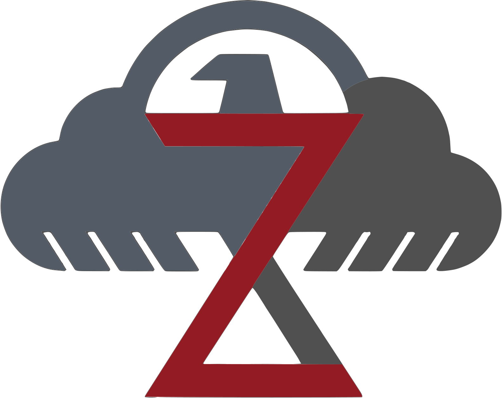
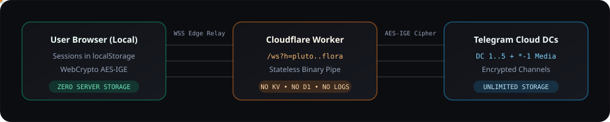

<div align="center">



<br />



<br />

<p>
  <a href="#-english"><strong>🇬🇧 English</strong></a>
  &nbsp;&nbsp;•&nbsp;&nbsp;
  <a href="#-فارسی-persian"><strong>🇮🇷 فارسی (Persian)</strong></a>
  &nbsp;&nbsp;•&nbsp;&nbsp;
  <a href="#-privacy--zero-knowledge-code-proof"><strong>🔐 Privacy Proof</strong></a>
  &nbsp;&nbsp;•&nbsp;&nbsp;
  <a href="#-deploy-to-cloudflare--custom-domain-guide"><strong>🚀 Deploy Guide</strong></a>
</p>

<p>
  
  
  
  
  
</p>

<br />

### 🚀 One-Click Personal Cloud Deployment

<a href="https://deploy.workers.cloudflare.com/?url=https://github.com/Zudiaq/Telflare">
  
</a>

<p><sub>Deploy your own private, unlimited <strong>Telflare (ZUD Cloud)</strong> instance directly to your Cloudflare account in under 60 seconds — zero databases, zero secrets, zero backend servers.</sub></p>

</div>

---

<a id="-english"></a>

## 🇬🇧 English

### ✨ What is Telflare (ZUD Cloud)?

**Telflare** *(powered by ZUD Cloud)* is a self-hosted, open-source, **unlimited Telegram cloud storage & web drive** deployed on **Cloudflare Workers with Static Assets**. It transforms your Telegram channels into a fast, modern cloud file manager with instant adaptive video streaming, frame-by-frame timeline preview scrubbing, 3-lane parallel uploads & downloads, a full music player, PDF & image viewers, and multi-account support — **running 100% in your browser**.

---

### ⚡ Core Engineering Highlights

| Feature | Technical Architecture |
| :--- | :--- |
| **🌐 Cloudflare Edge WebSocket Relay** | Stateless binary WebSocket relay (`/ws?h=...`) routes encrypted MTProto traffic across all 10 Telegram DCs (`pluto`, `venus`, `aurora`, `vesta`, `flora` + `-1` media DCs) with automatic reconnect. |
| **🚀 3-Lane Self-Healing MTProto Pool** | Persistent multi-lane `MTProtoSender` pool (`MAX_LANES_PER_DC = 3`) with priority concurrency gating so rapid seeks, hover snapshots, and uploads never drop or stall. |
| **🎬 Strict 100%-Gated Video Streaming** | Adaptive 256 KB streaming with zero-copy `Transferable` Service Worker piping, smooth `0% → 100%` progress bar, and strict playback gating until `100%` buffer runway is ready. |
| **🎞️ Frame-by-Frame Scrubbing** | Silky desktop hover & mobile touch timeline snapshots using `fastSeek`, buffered RAM frame playback, `1s` LRU cache, and GPU `translate3d` positioning. |
| **⬆️⬇️ 3-Lane Parallel Upload & Download** | 512 KB sliding-window uploads (`SaveBigFilePart` / `SaveFilePart`) and OPFS/in-memory downloads (full Chrome, Firefox & Safari compatibility) with `FLOOD_WAIT` & socket self-healing. |
| **🖼️ Guaranteed Video Cover Generation** | Hardware GPU 2×2 collage generator + Cloudflare-cached FFmpeg WASM fallback (`/api/ffmpeg/*`) with 24 MB head-slicing so even 2 GB+ MKV/AVI/MOV files never crash memory. |
| **🔒 100% Zero-Knowledge Privacy** | Zero backend database, zero KV/D1/R2 storage. Your Telegram session, auth keys, and files live **exclusively in your browser** and your own Telegram account. |

---

<a id="-deploy-to-cloudflare--custom-domain-guide"></a>

### 🛠️ Deploy to Cloudflare, Auto-Updates & Custom Domain Guide

#### 1. One-Click Deploy
1. Click the **Deploy to Cloudflare** button above.
2. Sign in to your **Cloudflare** account and authorize **GitHub**.
3. Cloudflare automatically forks `Zudiaq/Telflare` into your GitHub account, reads [`wrangler.jsonc`](wrangler.jsonc), runs `npm run build`, and deploys both the static UI (`./dist`) and the edge Worker (`./cf-worker/worker.js`).
4. Zero environment variables, zero KV namespaces, zero databases. Your personal cloud drive (`https://zud-cloud.<your-subdomain>.workers.dev`) goes live in ~60 seconds!
   > **Tip:** On some ISPs where the default `*.workers.dev` domain is unreachable or blank, attach a **Custom Domain** (Step 3 below) so your drive loads cleanly everywhere.

#### 2. Automatic Upstream Updates 🔄
Every fork deployed via the button includes [`.github/workflows/sync-upstream.yml`](.github/workflows/sync-upstream.yml):
- Open the **Actions** tab on your forked GitHub repository once and click **Enable workflows**.
- Every **6 hours** (or immediately whenever you click **Run workflow** / **Sync fork**), GitHub automatically pulls the latest releases from `Zudiaq/Telflare` into your `main` branch.
- **Cloudflare Workers Builds** detects the push and **automatically redeploys** your live instance with every new optimization!

#### 3. Attach a Custom Domain (Recommended)
1. In the **Cloudflare Dashboard**, navigate to **Workers & Pages** → select **`zud-cloud`**.
2. Go to **Settings** → **Domains & Routes** → click **+ Add** → select **Custom Domain**.
3. Enter your domain or subdomain (e.g., `cloud.yourdomain.com`) and click **Add domain**.
4. Cloudflare automatically issues SSL/TLS and routes both the WebUI and `/ws` WebSocket relay through your custom domain.

---

### 🏗️ Animated Architecture & Data Flow

<div align="center">
  
</div>

---

<a id="-privacy--zero-knowledge-code-proof"></a>

### 🔐 Privacy & Zero-Knowledge Code Proof

You never have to take privacy on faith. Inspect these exact files to verify that **no Telegram account, session string, phone number, auth key, or user file ever leaves your browser unencrypted or is stored on Cloudflare**:

| Security Guarantee | Exact Source File | Auditable Proof |
| :--- | :--- | :--- |
| **Browser-Only Session Storage** | [`src/lib/telegram.ts`](src/lib/telegram.ts) (`saveSession`, `saveStoredTelegramAccount`, `saveBotToken`) | All Telegram `StringSession` tokens, multi-account lists (`tg_accounts_v1`), and optional bot tokens are persisted **strictly in your browser's `localStorage`** — never sent to any backend API. |
| **Client-Side Auth Lifecycle** | [`src/context/TelegramContext.tsx`](src/context/TelegramContext.tsx) | Login, `checkAuthorization()`, account switching, and logout run 100% inside your browser via GramJS. |
| **End-to-End Local Encryption** | [`src/lib/webCryptoPatch.ts`](src/lib/webCryptoPatch.ts) & [`src/lib/proxiedSocket.ts`](src/lib/proxiedSocket.ts) | Every MTProto frame is encrypted with WebCrypto AES-IGE **inside your browser** before entering the WebSocket. |
| **Stateless Opaque Edge Relay** | [`cf-worker/worker.js`](cf-worker/worker.js) (`handleWebSocketTunnel`) | Strictly allowlists official Telegram Web DCs (`/^(pluto\|venus\|aurora\|vesta\|flora)(-1)?\.web\.telegram\.org$/`), piping raw encrypted binary frames with **zero logging, zero inspection, and zero storage**. Even the Worker owner cannot decrypt a single byte. |
| **Zero Cloud Storage Bindings** | [`wrangler.jsonc`](wrangler.jsonc) | Declares **no KV, no D1, no R2, and no Durable Objects** — only static read-only `ASSETS`. |

---

### 💻 Local Development

```bash
git clone https://github.com/Zudiaq/Telflare.git
cd Telflare
npm install
npm run dev       # Local Vite dev server
npm run build     # Production build -> ./dist
```

---

<br />

<a id="-فارسی-persian"></a>

<div dir="rtl">

## 🇮🇷 فارسی (Persian)

### ✨ Telflare (ZUD Cloud) چیست؟

**Telflare** *(بر پایه ZUD Cloud)* یک **فضای ابری نامحدود، رایگان و متن‌باز** بر بستر تلگرام و **Cloudflare Workers** است. این وب‌اپلیکیشن کانال‌های تلگرامی شما را به یک فایل‌منیجر و درایو ابری فوق‌سریع تبدیل می‌کند که شامل استریم فوری ویدیو، پیش‌نمایش فریم‌به‌فریم روی نوار زمان (دسکتاپ و موبایل)، آپلود و دانلود ۳ خطه موازی، موزیک‌پلیر، نمایشگر PDF و تصویر و مدیریت چند اکانت است — و **به‌طور کامل در مرورگر شما اجرا می‌شود**.

---

### 🚀 دیپلوی تک‌کلیک روی Cloudflare (بدون سرور و بدون دیتابیس)

<div align="center">
  <a href="https://deploy.workers.cloudflare.com/?url=https://github.com/Zudiaq/Telflare">
    
  </a>
</div>

#### ۱. راه‌اندازی شخصی در کمتر از ۶۰ ثانیه
1. روی دکمه **Deploy to Cloudflare** در بالا کلیک کنید.
2. وارد اکانت **Cloudflare** شوید و دسترسی **GitHub** را تایید کنید.
3. کلادفلر به‌صورت خودکار مخزن `Zudiaq/Telflare` را در گیت‌هاب شما فورک کرده، فایل [`wrangler.jsonc`](wrangler.jsonc) را می‌خواند، پروژه را بیلد می‌گیرد و هم رابط کاربری (`./dist`) و هم Worker (`./cf-worker/worker.js`) را بدون نیاز به دیتابیس یا هیچ تنظیم دستی دیپلوی می‌کند.
4. آدرس شخصی شما (`https://zud-cloud.<subdomain>.workers.dev`) در حدود ۱ دقیقه آماده است!
   > **نکته مهم:** در برخی اینترنت‌ها که دامنه پیش‌فرض `*.workers.dev` باز نمی‌شود یا صفحه خالی نمایش می‌دهد، کافی است یک **دامنه اختصاصی (Custom Domain)** مطابق مرحله ۳ متصل کنید تا پنل بدون هیچ مشکلی باز شود.

#### ۲. آپدیت خودکار با هر نسخه جدید 🔄
برای اینکه هر زمان آپدیت جدیدی روی مخزن اصلی (`Zudiaq/Telflare`) منتشر شد به‌صورت خودکار روی کلادفلر شما هم بنشیند:
- یک بار در مخزن فورک‌شده خود وارد تب **Actions** شوید و دکمه فعال‌سازی Workflowها را بزنید.
- ورک‌فلو [`.github/workflows/sync-upstream.yml`](.github/workflows/sync-upstream.yml) هر **۶ ساعت یک‌بار** (یا هر زمان دستی روی **Run workflow** / **Sync fork** بزنید) تغییرات جدید را روی برنچ `main` شما سینک می‌کند و **Cloudflare Workers** به‌طور خودکار نسخه جدید را دیپلوی می‌کند.

#### ۳. اتصال دامنه اختصاصی (Custom Domain)
1. در پنل **Cloudflare** به بخش **Workers & Pages** بروید و **`zud-cloud`** را انتخاب کنید.
2. وارد **Settings** ← **Domains & Routes** شوید و روی **+ Add** ← **Custom Domain** کلیک کنید.
3. دامنه یا ساب‌دامنه خود (مثلاً `cloud.yourdomain.com`) را وارد کنید تا گواهی SSL و مسیر `/ws` به‌صورت خودکار روی دامنه شما فعال شود.

---

### ⚡ قابلیت‌ها و معماری فنی

| قابلیت | جزئیات مهندسی |
| :--- | :--- |
| **🌐 رله وب‌سوکت Edge کلادفلر** | رله وب‌سوکت باینری بدون حالت (`/ws?h=...`) برای هر ۱۰ دیتاسنتر تلگرام (`pluto` تا `flora` و دیتاسنترهای مدیا `-1`) با اتصال مجدد خودکار. |
| **🚀 پول ۳ خطه خودترمیم MTProto** | اتصال همزمان تا ۳ خط وب‌سوکت روی هر دیتاسنتر (`src/lib/dcSenderPool.ts`) با اولویت‌بندی هوشمند برای جلوگیری از قطعی هنگام Seek و آپلود. |
| **🎬 پلیر ویدیو با گیت دقیق ۱۰۰٪** | استریم تطبیقی ۲۵۶KB، انتقال Zero-Copy به Service Worker و شروع پخش دقیقاً در لحظه رسیدن بافر به **۱۰۰٪**. |
| **🎞️ اسنپ‌شات نرم و فریم‌به‌فریم (موبایل و دسکتاپ)** | پیش‌نمایش زنده هنگام حرکت موس یا کشیدن انگشت روی نوار زمان بدون پرش به عقب، با `fastSeek`، کش رم و حرکت روان GPU. |
| **⬆️⬇️ آپلود و دانلود ۳ خطه بدون نوسان** | آپلود ۵۱۲KB با پنجره لغزان (`hydraUpload.ts`) و دانلود OPFS/حافظه سازگار با Chrome، Firefox و Safari و بازیابی خودکار `FLOOD_WAIT`. |
| **🖼️ تامبنیل تضمینی برای انواع ویدیو** | استخراج کلاژ ۲×۲ با GPU سخت‌افزاری + FFmpeg WASM کش‌شده از مسیر `/api/ffmpeg/*` با برش ۲۴MB ابتدایی برای جلوگیری از کرش رم. |

---

### 🔐 اثبات امنیت و حریم خصوصی (ذخیره‌سازی ۱۰۰٪ داخل مرورگر شما)

اگر این ریپو را روی کلادفلر یا هر سرویس دیگری دیپلوی کنید، **هیچ اطلاعاتی از اکانت تلگرام، سشن، کلید رمزنگاری یا فایل‌های شما روی سرور یا کلادفلر ذخیره نمی‌شود** و تمام داده‌ها منحصراً داخل مرورگر خود کاربر باقی می‌مانند:

| بخش امنیتی | مسیر دقیق در کد | توضیح فنی |
| :--- | :--- | :--- |
| **ذخیره محلی سشن‌ها** | [`src/lib/telegram.ts`](src/lib/telegram.ts) (توابع `saveSession` و `saveStoredTelegramAccount`) | تمام سشن‌های تلگرام (`tg_session`، `tg_accounts_v1` و `tg_bot_token`) صرفاً در `localStorage` مرورگر خود کاربر ذخیره می‌شوند. |
| **احراز هویت سمت کلاینت** | [`src/context/TelegramContext.tsx`](src/context/TelegramContext.tsx) | ورود، بررسی وضعیت سشن، تعویض اکانت و خروج کاملاً در مرورگر اجرا می‌شود. |
| **رمزنگاری سرتاسری در مرورگر** | [`src/lib/webCryptoPatch.ts`](src/lib/webCryptoPatch.ts) و [`src/lib/proxiedSocket.ts`](src/lib/proxiedSocket.ts) | بسته‌های MTProto پیش از خروج از مرورگر با AES-IGE رمزنگاری می‌شوند. |
| **رله بی‌حالت و غیرقابل‌شنود کلادفلر** | [`cf-worker/worker.js`](cf-worker/worker.js) (تابع `handleWebSocketTunnel`) | فقط فریم‌های باینری رمزنگاری‌شده را بین مرورگر و دامنه‌های رسمی تلگرام عبور می‌دهد؛ بدون هیچ لاگ، دیتابیس یا امکان رمزگشایی. |
| **بدون هیچ فضای ذخیره‌سازی ابری** | [`wrangler.jsonc`](wrangler.jsonc) | هیچ اتصال `KV`، `D1` یا `R2` تعریف نشده و تنها فایل‌های استاتیک رابط کاربری سرو می‌شوند. |

</div>

---

<div align="center">
  <sub>
    <strong>Topics &amp; Keywords:</strong>
    telegram-cloud • unlimited-cloud-storage • cloudflare-workers • telegram-drive • mtproto • self-hosted-cloud • video-streaming • web-drive • telflare • zud-cloud • فضای-ابری-تلگرام • فضای-ابری-نامحدود • کلادفلر
  </sub>
</div>
